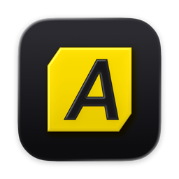

<div align="center">

<h1>Asahiro</h1>
<p>A macOS launcher for a Zertain Zanime Zame</p>
</div>

## Features

- Installs, updates, verifies and repairs the game
- Bundled wine runner, set up automatically
- D3DMetal by default, DXMT for mods
- macOS Game Mode support
- Built-in mod loader and mod manager
- Directly launch the game from Launchpad, Spotlight or the Dock
- MetalFX, DirectX 12 and the Metal HUD

## Using Asahiro

Requirements: an Apple Silicon Mac on macOS 26 or later with Rosetta 2. [CrossOver](https://www.codeweavers.com/crossover) is optional and only needed for D3DMetal.

1. Download the latest `Asahiro-<version>.dmg` from the releases page and drag Asahiro into Applications.
2. Asahiro is not notarized, so macOS blocks it on first open. Go to System Settings, Privacy & Security, and click Open Anyway.
3. Pick a game folder, or point Asahiro at an existing install, and click Install.
4. Click Start Game. The first launch downloads the wine runner (about 450 MB) and creates the bottle.
5. To use mods, turn on Enable mods in the Mods settings, then add mods from the Mods panel in the gear menu.

Mods may go against the game's terms of service so use them at your own risk (or on a throwaway account :) ).

## Building

You need:

- [Xcode](https://apps.apple.com/us/app/xcode/id497799835) 26 or later
- [Rust](https://rustup.rs), stable
- Optional: `mingw-w64` (`brew install mingw-w64`) to rebuild the mod injector. A prebuilt copy is included with the repo.
- Optional: `create-dmg` (`brew install create-dmg`) to build the dmg image

Build the app into `dist/Asahiro.app`:

```bash
./scripts/build.sh
```

Build the dmg image into `dist/Asahiro-<version>.dmg`:

```bash
./scripts/build-dmg.sh
```

## Special thanks

- [YAAGL](https://github.com/yaagl/yet-another-anime-game-launcher) for the update logic, wine runner, DXMT builds and launch workarounds
- [DXMT](https://github.com/3Shain/dxmt)
- [CodeWeavers](https://www.codeweavers.com) for CrossOver, and the [Wine](https://www.winehq.org) project
- Apple for D3DMetal
- [XXMI](https://github.com/SpectrumQT/XXMI-Launcher) and [3DMigoto](https://github.com/bo3b/3Dmigoto)
- [HDiffPatch](https://github.com/sisong/HDiffPatch)
- [Chakra Petch](https://fonts.google.com/specimen/Chakra+Petch) by Cadson Demak

Asahiro is not affiliated with CodeWeavers or Apple.

## License

MIT
